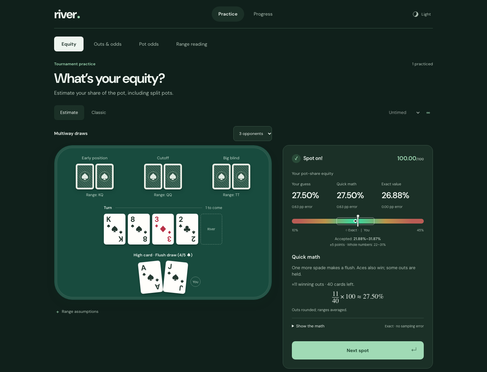
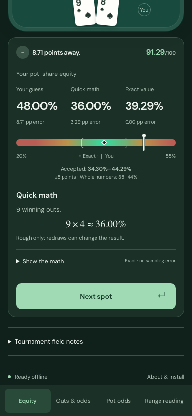
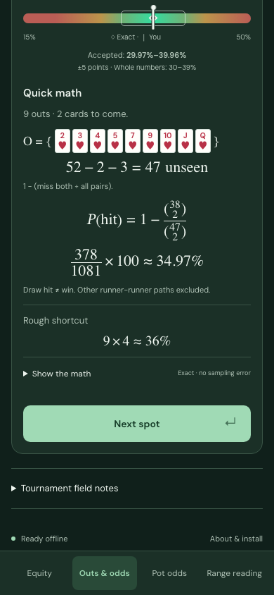

# River

[](https://github.com/Nano-AI/river/actions/workflows/ci.yml)

**Build your poker probability intuition.**

River is a phone-first No-Limit Texas Hold’em practice app. Estimate an answer, see how close you were, and learn the math behind it. All 69 scenarios have exact answers computed from a standard 52-card deck.

No account. No ads. Progress stays on your device. Works offline after the first visit.



## Practice

| Drill | What you learn |
| --- | --- |
| **Equity** | Your share of the pot against a hand or range, including four-way pots and split pots. |
| **Outs & odds** | Which cards complete your draw, and the probability of hitting one. |
| **Pot odds** | The price of a call and the extra payout needed to break even. |
| **Range reading** | How blockers change combinations of made hands, draws, and air. |

- **Estimate mode:** enter a number or use the slider. A focused heatmap shows your guess against the exact answer: green near the target, amber then red farther away. Close answers get a brief celebration.
- **A fair margin:** equity guesses within **±5 percentage points** earn full credit. The accepted interval is visible after answering. This is a practice allowance, not a statistical confidence interval.
- **Learn, then speed up:** practice untimed or choose a 10-, 20-, or 30-second clock. Classic mode keeps the original question formats.
- **Real explanations:** readable out-card sets, typeset fractions and combinations, plus rough mental shortcuts. Expand **Show the math** for exact counts and measured shortcut errors.
- **Hidden hands:** choose **3 opponents** to practice four-way pots. Each hidden seat has an explicit range; no secret hand is invented after you answer.
- **Progress:** revisit weak drills and rules. History, theme, and timing preferences are saved locally.

<table>
  <tr>
    <td></td>
    <td></td>
  </tr>
</table>

Light and dark themes, keyboard controls, mobile bottom navigation, and reduced-motion support are included. Equations use native MathML; the combination formulas also include LaTeX annotations. There is no external math-rendering service.

## Run locally

Requires **Node.js 24 or newer**.

```sh
git clone https://github.com/Nano-AI/river.git
cd river
npm ci
npm run build
npm run dev
```

Open **http://127.0.0.1:4173**.

`npm run preview` serves the production build from `dist/`. Stop the development server first, or use `PORT=8080 npm run preview`.

## How the math is checked

Answers are precomputed by exhaustive enumeration, not random percentage generation:

1. Start with 52 unique cards and reject duplicate or overlapping cards.
2. Expand the stated opponent ranges into every legal joint deal.
3. Enumerate the remaining boards and rank each player’s best five-card hand.
4. Count wins, losses, and split pots. A three-way tie earns one third of the pot.

The tests check all **2,598,960 five-card hands** against the standard category frequencies, compare **2,000 seven-card hands** with an independent evaluator, and verify known equity references. Every authored multiway result is separately checked using independent deal expansion and five-card-subset ranking.

For example, A♠ J♠ on K♠ 8♠ 3♦ 2♣ is a **flush draw**: four spades, with one more needed. Against the lesson’s KQ / QQ / TT ranges, enumeration produces **2,322 wins in 8,640 outcomes: 26.875%**.

The rule of 2/4 is a shortcut, not an exact answer. Four-way turn lessons use rounded clean outs over the actual remaining deck size. Shortcut errors are measured and published in [MATH.md](MATH.md).

## Card notation

The table and out sets show card faces. Source scenarios also use compact notation:

| Code | Meaning |
| --- | --- |
| `As` | A♠ — ace of spades |
| `Ts` | 10♠ — ten of spades |
| `AhKh` | A♥ K♥ — a specific two-card hand |
| `TT` | Any pocket tens |
| `AKs` / `AKo` | Ace-king suited / offsuit |

In a **card code**, `s`, `h`, `d`, and `c` mean spades, hearts, diamonds, and clubs. In a **range token** such as `AKs`, the final `s` means *suited*.

## Verify changes

```sh
npx playwright install chromium webkit
npm run verify
```

This builds the app and runs the Node/math tests plus Chromium and WebKit browser tests. The browser suite covers the authored flows, accessibility, narrow layouts, animations, reduced motion, persistence, and offline use. CI runs the browser suite on macOS, matching the locally checked WebKit platform. One WebKit service-worker inspection test is skipped; Chromium exercises the full offline lifecycle.

Useful commands:

| Command | Purpose |
| --- | --- |
| `npm run math:audit` | Regenerate the measured shortcut report after changing the engine, rules, or audit corpus. |
| `npm run build` | Recompute answers, regenerate icons and the offline cache, and produce `dist/`. |
| `npm test` | Run engine, grading, DOM, server, and static-asset tests. |
| `npm run test:e2e` | Run real-browser checks against the built app. |
| `npm run screenshots` | Capture phone and desktop screens in both themes. |
| `npm run animations` | Capture real animation frames and videos. |

Run the build after a math audit. Tests deliberately reject stale answers, audit reports, or cache hashes. Generated screenshots, browser reports, and `dist/` are excluded from Git; the README images are curated captures in `docs/images/`.

## Publish

River is a static site. Host **the contents of `dist/`** over HTTPS; no backend, API keys, or database are needed. Root paths and subdirectories both work.

**GitHub Pages:** in the repository’s **Settings → Pages**, select **GitHub Actions** as the source. Then open **Actions → Publish to GitHub Pages → Run workflow** on `main`. The workflow builds and checks the app before deployment. The expected address is `https://nano-ai.github.io/river/` once Pages is enabled and deployment succeeds.

Publishing is manual. Pushes and pull requests run CI and produce a downloadable `river-site` artifact; they do not deploy the website automatically.

See [DEPLOY.md](DEPLOY.md) for other hosts, cache updates, and installation. Close existing River tabs or installed windows and reopen after an update so the new offline version can activate.

## Scope

River teaches probability and chip-equity intuition for tournament preparation. It does not simulate betting decisions, opponent behavior, side pots, or tournament payouts. Ranges are stated assumptions, equally weighted over legal deals. ICM, stack sizes, and future betting can change the right decision.

Browser testing does not establish physical-phone frame rate or screen-reader behavior. Clearing site data removes local progress; there is no cloud backup.

## Project map

| Path | Responsibility |
| --- | --- |
| `src/engine.js` | Card validation, hand ranking, exact equity, outs, ranges, and pot EV |
| `src/scenarios.js` | Authored hands and explicit assumptions |
| `src/rules.js` | Mental shortcuts and worked-step data |
| `public/` | Dependency-free interface, assets, and generated offline data |
| `scripts/` | Build, math audit, local server, and visual captures |
| `tests/` | Independent references, unit tests, and browser checks |
| `.github/workflows/` | Continuous verification and manual Pages publishing |

The bundled [DM Sans font](public/fonts/OFL.txt) is licensed under the SIL Open Font License.
